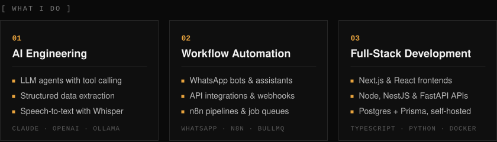
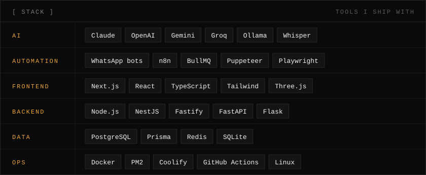
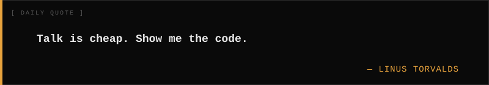

  

 

  I build <b>AI agents</b>, <b>workflow automation</b> and <b>full-stack products</b> for real businesses, 
  and take them from the first commit to a self-hosted deploy.

 

  

 

  

 

  <picture>
    <source media="(prefers-color-scheme: dark)"  srcset="assets/generated/github-contribution-grid-snake-dark.svg">
    <source media="(prefers-color-scheme: light)" srcset="assets/generated/github-contribution-grid-snake.svg">
    
  </picture>

 

  

 

  
  

