  

  

 

---

## About

I'm **Kaarthic Raja**, an **AI & automation engineer** and full-stack developer from India. I build AI agents, LLM-powered products, web apps and automation for real businesses, and I take them all the way from the first commit to a self-hosted deploy.

- **AI engineering**: LLM agents, structured extraction and speech-to-text, built on Claude, OpenAI, Gemini, Groq and local Ollama models
- **Workflow automation**: WhatsApp bots, voice-note workflows and n8n pipelines that turn chat and voice into real work
- **Full-stack web apps**: Next.js, React and TypeScript on Node.js / NestJS or Python backends
- **Data**: PostgreSQL with Prisma, Redis for queues and background jobs
- **Shipping**: Docker, PM2 and GitHub Actions, self-hosted on Linux
- **Multilingual**: products that understand Tamil and English
- **AI-native workflow**: Claude Code agents in the terminal every day

---

## Stack

  

---

## GitHub Stats

  

 

  

---

## Contribution Snake

  <picture>
    <source media="(prefers-color-scheme: dark)"  srcset="assets/generated/github-contribution-grid-snake-dark.svg">
    <source media="(prefers-color-scheme: light)" srcset="assets/generated/github-contribution-grid-snake.svg">
    
  </picture>

---

## Daily Quote

  

  Auto-updated every 24h by <code>quote.yml</code>

---

&nbsp;

&nbsp;

---

## Connect

